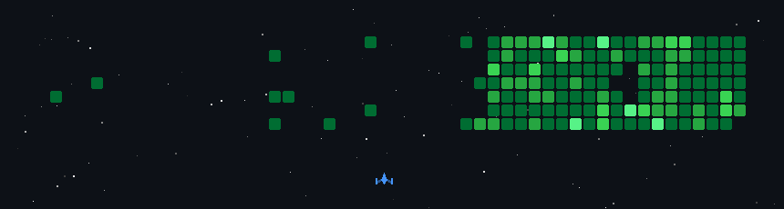

<svg xmlns="http://www.w3.org/2000/svg" viewBox="0 0 1000 320">
<defs>
  <linearGradient id="sky" x2="0" y2="1">
    <stop stop-color="#171820"/>
    <stop offset=".55" stop-color="#672c2d"/>
    <stop offset="1" stop-color="#d16b48"/>
  </linearGradient>
  <linearGradient id="red" x2="1">
    <stop stop-color="#b91c1c"/>
    <stop offset="1" stop-color="#f97316"/>
  </linearGradient>
</defs>

<rect width="1000" height="320" rx="14" fill="url(#sky)"/>

<!-- Sun -->
<circle cx="790" cy="135" r="85" fill="#ef7653" opacity=".55"/>
<circle cx="790" cy="135" r="65" fill="#f5a16b" opacity=".35"/>

<!-- Smoke -->
<g fill="#25252a" opacity=".65">
 <path d="M550 180 Q510 110 570 90 Q580 30 640 55 Q690 15 720 85 Q760 90 750 145Z"/>
 <path d="M850 150 Q810 80 870 55 Q900 15 940 75 Q985 90 960 155Z"/>
</g>

<!-- Colossal Titan silhouette -->
<g fill="#211c1d" stroke="#352326" stroke-width="2">
 <path d="M700 320 Q700 245 720 210 L720 140 Q700 110 720 75
 Q755 30 805 60 Q845 90 830 145 L850 205 Q885 240 890 320Z"/>
 <path d="M720 115 Q690 65 725 35 L755 65 L775 15 L800 60
 L825 25 Q855 75 830 120Z"/>
 <path d="M735 135 L760 145 L780 135 L800 145 L820 135"
 fill="none" stroke="#e1a18a" stroke-width="3"/>
</g>

<!-- Wall -->
<path d="M0 220 L1000 220 L1000 320 L0 320Z" fill="#333333"/>
<path d="M0 220 H1000" stroke="#a6a29a" stroke-width="7"/>
<g stroke="#77736d" stroke-width="2" opacity=".5">
 <path d="M100 220V320 M250 220V320 M420 220V320 M580 220V320 M950 220V320"/>
</g>

<!-- Scouts -->
<g fill="#151c20">
 <path d="M570 220 L590 180 L610 220Z"/>
 <path d="M620 220 L640 165 L660 220Z"/>
 <path d="M650 220 L680 190 L700 220Z"/>
</g>

<!-- Wings inspired emblem -->
<g transform="translate(90 80)" fill="none" stroke="#d9e3db" stroke-width="3" opacity=".85">
 <path d="M0 0 Q-45 -25 -65 -5 Q-30 5 -10 20 Q-45 15 -55 35 Q-15 35 0 20"/>
 <path d="M0 0 Q45 -25 65 -5 Q30 5 10 20 Q45 15 55 35 Q15 35 0 20"/>
 <path d="M0 -15 V35"/>
</g>

<!-- Profile text -->
<text x="85" y="165" fill="#ffffff" font-family="Arial"
font-size="38" font-weight="bold" letter-spacing="2">
ABHISHEK SHARMA
</text>
<path d="M85 180 H460" stroke="url(#red)" stroke-width="4"/>
<text x="87" y="212" fill="#e5e5e5" font-family="monospace"
font-size="15" letter-spacing="2">
BEYOND THE WALLS, BEYOND THE LIMITS.
</text>
<text x="87" y="245" fill="#c9c5c1" font-family="monospace" font-size="12">
FULL-STACK DEVELOPER | CREATIVE BUILDER
</text>
<text x="87" y="290" fill="#b9b5b0" font-family="monospace" font-size="11">
github.com/sharmaa-abhi
</text>
</svg>


<div align="center">

  <!-- DYNAMIC TYPING HERO -->
  

  <br />

  <!-- TERMINAL BRAND BANNER -->
  

  <br /><br />

  <p align="center">
    <strong>🚀 Full-Stack & Frontend Engineer</strong> dedicated to building high-performance web applications,<br />
    responsive interfaces, and interactive software experiences.
  </p>

  <p align="center">
    <a href="https://github.com/sharmaa-abhi?tab=repositories">
      
    </a>
    <a href="mailto:sharmaa24434@gmail.com">
      
    </a>
  </p>

</div>

<br />
<hr />
<br />

<!-- ABOUT & OVERVIEW -->
### ⚡ About Me

```bash
sharmaa-abhi@portfolio:~$ cat overview.json
{
  "name": "Abhishek Sharma",
  "role": "Frontend & Full-Stack Engineer",
  "interests": ["Scalable Web Architecture", "Interactive Graphics", "Open Source Tools"],
  "currently_learning": ["Advanced Distributed Systems", "High-Performance WebGL"],
  "motto": "Build fast, iterate with precision, ship with confidence."
}
```

<br />
<hr />
<br />

<!-- AUTOMATED CONTRIBUTION SHOWCASE -->
<div align="center">

  <h3>🎮 Contribution Space Shooter</h3>
  <p><em>Automated dynamic arcade simulation rendered from live GitHub contribution telemetry.</em></p>

  <br />

  

</div>

<br />
<hr />
<br />

<!-- TECH STACK BENTO MATRIX -->
<div align="center">

  
</div>

<br />
<hr />
<br />

<!-- GITHUB ACTIVITY & METRICS (GEN-Z BENTO) -->
<div align="center">

  <p>
    
  </p>

  <h3>⚡ Proof of Work // The Green Square Grindset 🟩</h3>
  <p><em>Consistent engineering, thoughtful iterations, and shipping useful software.</em></p>

  <br />

  <!-- Snake Contribution Hero -->
  <picture>
    <source media="(prefers-color-scheme: dark)" srcset="https://raw.githubusercontent.com/sharmaa-abhi/sharmaa-abhi/output/github-contribution-grid-snake-dark.svg" />
    <source media="(prefers-color-scheme: light)" srcset="https://raw.githubusercontent.com/sharmaa-abhi/sharmaa-abhi/output/github-contribution-grid-snake.svg" />
    
  </picture>

  <br /><br />

  <!-- GitHub Streak Activity Card -->
  <a href="https://github.com/sharmaa-abhi">
    
  </a>

</div>

<br />
<hr />
<br />

<!-- CONNECT WITH ME -->
<div align="center">

  <h3>🤝 Connect & Collaborate</h3>
  <p>Feel free to reach out for project collaborations, engineering discussions, or innovative opportunities.</p>

  <br />

  <p>
    <a href="mailto:sharmaa24434@gmail.com">
      
    </a>
    <a href="https://www.linkedin.com/in/abhishek-sharma-88876b389/" target="_blank">
      
    </a>
  </p>

</div>
